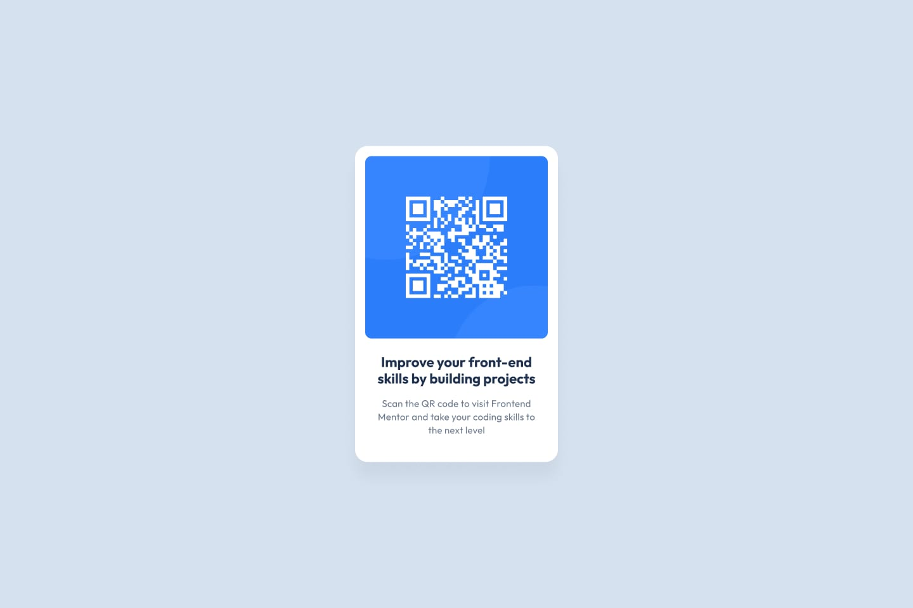

# Frontend Mentor - QR code component solution

This is a solution to the [QR code component challenge on Frontend Mentor](https://www.frontendmentor.io/challenges/qr-code-component-iux_sioA2). Frontend Mentor challenges help you improve your coding skills by building realistic projects.

## Overview

### The challenge

Users should be able to:

- View the optimal layout depending on their device's screen size
- See hover and focus states for interactive elements

### Screenshot



### Links

- Solution URL: [https://github.com/kaina-slimani/qr-code-component](https://github.com/kaina-slimani/qr-code-component)
- Live Site URL: [https://kaina-slimani.github.io/qr-code-component/](https://kaina-slimani.github.io/qr-code-component/)

## My process

### Built with

- Semantic HTML5 markup
- CSS custom properties & modern reset
- Flexbox for layout and centering
- Mobile-friendly responsive workflow

### What I learned

During this challenge, I reinforced key layout and typography concepts:
1. Centering a component both vertically and horizontally in the viewport using `min-height: 100vh` and Flexbox auto-margins.
2. Managing fluid card widths with `max-width` combined with horizontal padding to achieve clean 2-to-3 line text wrapping while strictly respecting the style guide's 15px paragraph font size requirement.
3. Integrating Google Fonts via the variable font link in the `<head>`.

```css
.card {
  width: 90%;
  max-width: 320px;
  background-color: hsl(0, 0%, 100%);
  border-radius: 20px;
  padding: 16px;
}
```

### Continued development
For upcoming challenges, I plan to dive deeper into CSS custom properties (variables) for scalable color themes and adopt a strict mobile-first workflow from the wireframing stage.

### Author

- Frontend Mentor - [@kaina-slimani](https://www.frontendmentor.io/profile/kaina-slimani)
- GitHub - [@kaina-slimani](https://github.com/kaina-slimani)
